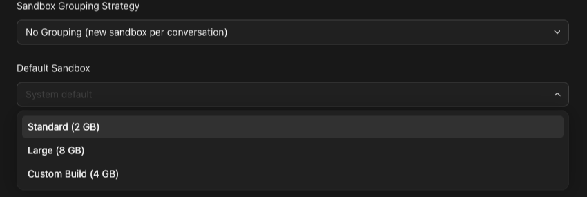

# Default Sandbox Spec in Settings

A browser ran the PR’s **Settings → Application** UI with a synthetic Runtime API catalog and Settings API. The dropdown displayed friendly names. The screenshot shows the available choices.

| Browser action | Observed result |
| --- | --- |
| Select **Large (8 GB)** and click **Save** | `POST /api/v1/settings` sent `{"default_sandbox_spec_id":"v1_large"}` and received HTTP 200. |
| Read the setting back | `GET /api/v1/settings` returned `default_sandbox_spec_id: "v1_large"`. |

The table shows the fields relevant to this check. The separate live EKS test exercised sandbox provisioning and verified the running image and resource limits.
