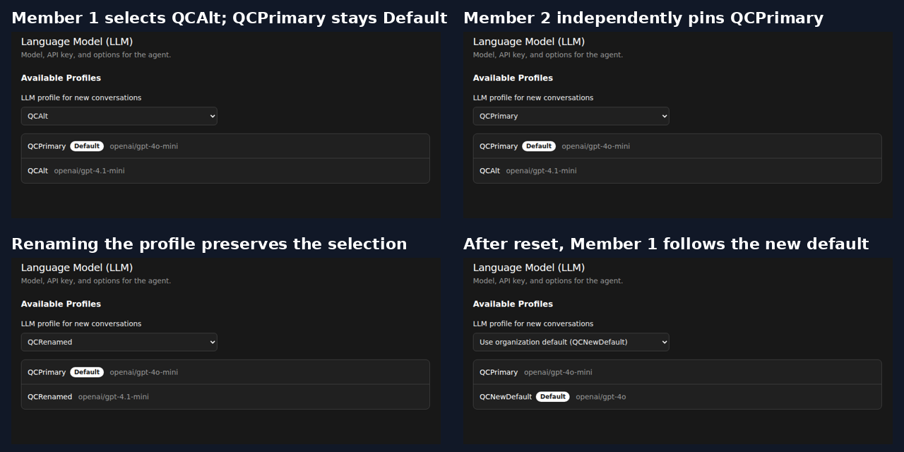

# Member LLM selection — local Compose evidence

Chromium ran against the isolated `llm-selection-evidence-fixed-1492` Docker Compose project. It used the `6425709` backend image and the frontend rebuilt from `d3bc556`, with user LLM configuration disabled. The organization and both member accounts were disposable fixtures.

| Scenario | Observed result |
|---|---|
| Untouched member | [No explicit override](01-untouched.png) |
| Member 1 selects an alternate and reloads | [Alternate remains selected; the organization badge stays on the default](02-alternate-after-reload.png) |
| Member 2 independently selects the original default | [A different selection persists](03-second-member.png); changing one member did not change the other |
| Admin renames the alternate | [Member 1 still selects the renamed profile](04-renamed.png) |
| Member 1 resets and reloads | [Follows the organization default](05-reset.png) |
| Admin deletes an explicitly selected alternate | [Selection falls back to the organization default](06-deleted-fallback.png) |
| Admin changes the default again | [Member 1 follows the new default](07-new-org-default.png); member 2 stays pinned to the old profile |
| Invalid name; member attempts shared changes | API returned 404 for an unknown selection and 403 for organization activation, rename, and delete. Member selection and org default stayed unchanged. |
| Credential exposure | Profile list, profile detail, and selection responses did not contain the stored dummy provider key. |

[Before the badge fix](before-badge.png), the badge incorrectly moved to the member's selection even though the API's org default was unchanged. The new Vitest assertion reproduced this before the fix; all five manager tests passed afterward.

A separate check inside the Compose app exercised `SaasSettingsStore.load(resolve_agent_profile=True)`: after changing the default, it resolved `openai/gpt-4o` for the member following the default and `openai/gpt-4o-mini` for the other member. That checks launch-time model resolution, not a completed provider-backed conversation. The [hosted verifier](https://github.com/OpenHands/saas-deploy/pull/2468#issuecomment-7055349797) checked persistence and reset but could not distinguish provider routing because both hosted profiles used the same model. Its run predates the badge fix.
